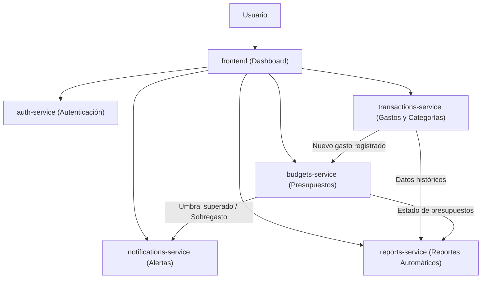

# Centavo

**Centavo** es una aplicación de finanzas personales diseñada para uso individual, enfocada en el registro de gastos, el control de presupuestos y la emisión de alertas tempranas de sobregasto.

## Estructura del Monorepo y Componentes

El proyecto está organizado como un monorepo donde cada pieza cumple una responsabilidad específica dentro del sistema:

```text
CENTAVO/
├── frontend/               # Dashboard web principal
├── auth-service/           # Microservicio de autenticación
├── transactions-service/   # Microservicio de transacciones y categorías
├── budgets-service/        # Microservicio de presupuestos
├── notifications-service/  # Microservicio de alertas de sobregasto
└── reports-service/        # Microservicio de reportes automáticos
```

### Propósito de cada pieza

- **`frontend` (Dashboard):** Interfaz de usuario desde donde se registran movimientos, se configuran presupuestos, se consultan reportes visuales y se reciben notificaciones de estado financiero.
- **`auth-service`:** Gestiona la identidad del usuario, inicio de sesión, emisión y validación de tokens (por ejemplo, JWT) para proteger el acceso al resto de los servicios.
- **`transactions-service`:** Encargado del alta, edición, consulta y categorización de los gastos e ingresos registrados por el usuario.
- **`budgets-service`:** Administra los límites de gasto definidos por categoría o período (mensual, semanal) y evalúa el consumo acumulado frente a las transacciones registradas.
- **`notifications-service`:** Procesa eventos de sobregasto o cercanía al límite presupuestario y envía alertas al usuario (en el dashboard, correo u otros canales).
- **`reports-service`:** Consolida datos históricos de transacciones y presupuestos para generar resúmenes periódicos y reportes automáticos de salud financiera.

---

## Diagrama de Arquitectura



## Flujo Principal de Uso

1. **Autenticación:** El usuario inicia sesión a través del `frontend`, que valida las credenciales mediante `auth-service`.
2. **Registro de gastos:** Cuando el usuario registra un gasto en `transactions-service`, este se almacena y categoriza.
3. **Evaluación de presupuesto:** `budgets-service` contrasta el nuevo gasto con el límite configurado para esa categoría.
4. **Alertas de sobregasto:** Si el gasto supera o se acerca al umbral definido, `budgets-service` dispara un evento hacia `notifications-service` para alertar al usuario.
5. **Reportes:** `reports-service` recopila la información de gastos y presupuestos para construir balances y reportes automáticos.
